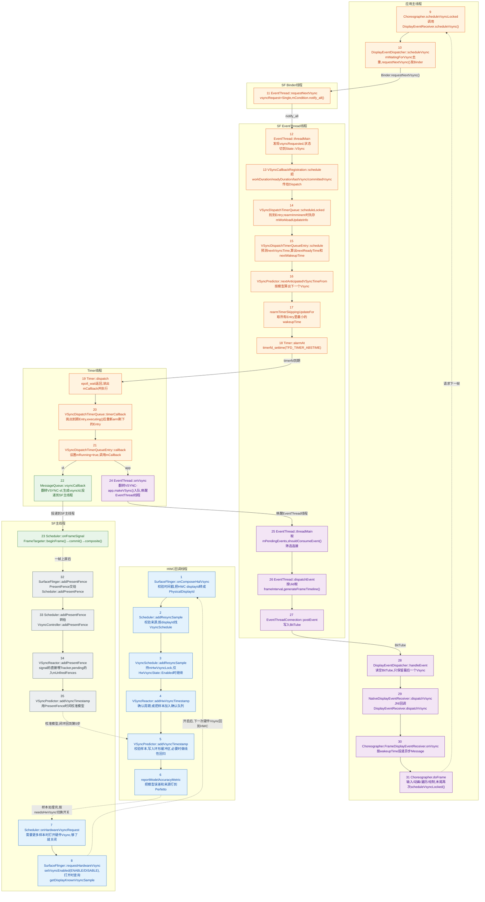

# 一个Vsync信号的完整流转图

本文是[Vsync信号完整流转.md](Vsync信号完整流转.md)第7节"全链路分步清单"的配图,以`android-17.0.0_r1`为准。图中节点编号与清单序号一一对应,节点内第一行是函数名,第二行是关键动作;实线表示按时间先后的调用,虚线表示闭环回边。

## 1 全链路总图



## 2 怎么读这张图

### 2.1 颜色对应五个阶段

| 颜色 | 节点 | 阶段 |
|---|---|---|
| 蓝色 | 1~8 | 硬件Vsync进入SurfaceFlinger,并决定硬件Vsync开还是关 |
| 橙色 | 9~21 | 应用请求Vsync,EventThread算出时间点并布防Timer |
| 绿色 | 22~23 | `"sf"`路径,Timer回调让SurfaceFlinger开始一帧 |
| 紫色 | 24~31 | `"app"`路径,Vsync经BitTube送回应用并触发`doFrame` |
| 灰色 | 32~35 | PresentFence反馈,反过来校准预测模型 |

### 2.2 图里有三个闭环

- 硬件Vsync开关闭环:1→2→3→4→5→6→7→8,第8步打开硬件Vsync后,下一次HWC回调又回到第1步。样本攒够后第7步会关闭硬件Vsync,这个环就停转,只剩PresentFence继续喂模型。
- 请求/分发闭环:9→10→11→12→13→14→15→16→17→18→19→20→21,然后分叉到`"sf"`(22→23)和`"app"`(24→31),应用在`doFrame`末尾再次请求,虚线回到第9步。
- 校准闭环:第23步合成完成、帧上屏后产生PresentFence,32→33→34→35,虚线回到第5步,和第1步的硬件样本走同一个`VSyncPredictor::addVsyncTimestamp`入口。

### 2.3 四个容易看错的细节

- 第7、8步画在SF主线程的泳道里,调用起点却在HWC回调线程:第4步`VSyncReactor::addHwVsyncTimestamp`把`needsHwVsync`返回给第3步`VsyncSchedule::addResyncSample`,后者在锁外调用`enableHardwareVsync()`或`disableHardwareVsync()`,再经过注册进`VsyncSchedule`的`mRequestHardwareVsync`回调进入第7步`Scheduler::onHardwareVsyncRequest`。该函数用`schedule()`把真正的处理投到主线程,而且只有`HwVsyncState`真正翻转时才会走到第8步,所以图中第6步到第7步画成虚线,它不是一次普通函数返回。
- 第8步打开硬件Vsync时,只有`get_display_known_vsync_sample_enabled()`这个flag打开,才会用`getDisplayKnownVsyncSample()`拿到的样本再调一次`mScheduler->addResyncSample(..., VSyncTimeSource::HwVsyncQuery)`,相当于从第8步直接绕回第2步,不用等HWC下一次回调。
- 第17步不是每次`scheduleLocked`都执行:`VSyncDispatchTimerQueue::scheduleLocked`只在`callback->wakeupTime() < mIntendedWakeupTime - mTimerSlack`时才调用`rearmTimerSkippingUpdateFor(now, it)`,并且会跳过刚刚`schedule()`过的那个Entry,给其余Entry做`update()`后取最小的`wakeupTime`。如果新的唤醒时间不比已布防的时间早,定时器保持原样,不会重新arm。
- 第21步之后的两条路径由同一条Timer线程串行执行:先收集到期的Entry,再在锁外依次调用`MessageQueue::vsyncCallback`和`EventThread::onVsync`。两者的`wakeupTime`落在`mTimerSlack = 500us`以内时,Perfetto里看到的是同一次`timerCallback`唤醒。

### 2.4 时间点标注

图中第15步算出的三个时间点是整条链路的骨架,和[Vsync信号完整流转.md](Vsync信号完整流转.md)第8节一致:

```text
nextWakeupTime          nextReadyTime              nextVsyncTime
     │                       │                          │
     │  workDuration         │  readyDuration           │
     ├──────────────────────►├─────────────────────────►│
   Timer在此时唤醒         应用必须把buffer交给SF    这一帧上屏
   (nextWakeupTime)        (nextReadyTime)           (nextVsyncTime)
```

三个时间点都在第15步`VSyncDispatchTimerQueueEntry::schedule`里算好,第18步布防的是`nextWakeupTime`;`VSyncDispatchTimerQueueEntry::callback(nsecs_t vsyncTimestamp, nsecs_t wakeupTimestamp, nsecs_t deadlineTimestamp)`再把这三个值原样交给`MessageQueue::vsyncCallback`和`EventThread::onVsync`。
